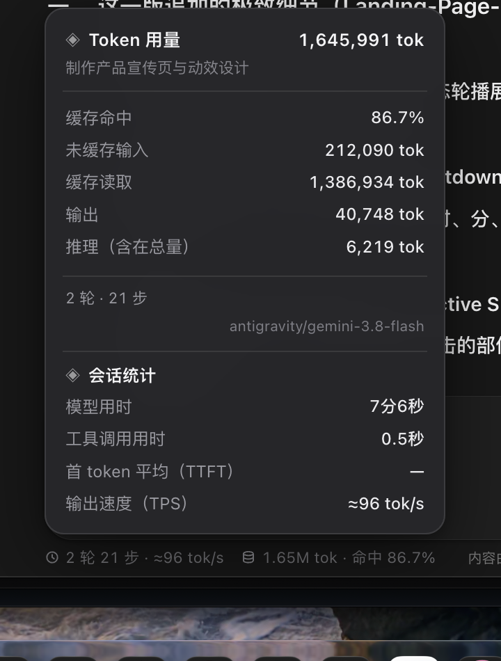

<div align="center">

# mimo-meter

**给 MiMo Desktop 加一条常驻状态栏：Token 用量 · 步数 · 缓存命中率 · 费用**

[](LICENSE)
[](../../releases)
[](#-平台支持)
[](#-隐私与安全)

[这是什么](#-这是什么) · [功能](#-功能) · [截图](#-截图) · [快速开始](#-快速开始) · [配置](#配置) · [数据口径](#-数据口径) · [工作原理](#-工作原理) · [排错](#-排错) · [FAQ](#-faq)

</div>

---

> [!WARNING]
> **非官方项目**。本项目通过读取 MiMo Desktop 的本地运行时与 SQLite 数据库实现，
> 不修改 `app.asar`、不改运行时文件、不动代码签名。
> MiMo 升级后内部结构可能变化，届时需要跟随适配。请自行评估在正式环境使用的风险。

---

## 📖 这是什么

MiMo Desktop 不显示一个会话烧了多少 token、缓存命中了多少、花了多少钱。
**mimo-meter** 在输入框下方补一行常驻状态，点开还有明细卡片：

```
🕐 2 轮 21 步 · ≈96 tok/s   🗄 1.65M tok · 命中 86.7%      内容由 AI 生成，请注意核实
└──────────────── 状态栏 ────────────────┘                └──── app 原有文案保持居中 ────┘
```

它**只做三件事**：往 `engine-config/` 放 3 个文件、在 `mimocode.jsonc` 登记一行、注入一段浮层。
卸载就是删掉这些文件，应用完全还原。

## ✨ 功能

- **实时状态栏** —— 轮数、步数、输出速度、总 token、缓存命中率，随会话滚动更新（400ms 合并刷新）
- **明细卡片** —— 缓存读取/写入、未缓存输入、输出、推理、模型用时、工具调用用时、TTFT、TPS、费用
- **按会话精确统计** —— 切会话数字跟着换，不会串号
- **首页不显示** —— 没有会话就没有数字，不在空页面上编造数据
- **三档自适应宽度** —— 窗口变窄自动降级文案，永远不会盖住 app 自己的居中免责声明
- **跟随主题** —— 浅色/深色自动切换
- **零依赖** —— 只用 Electron + Node 标准库，无原生模块、无需编译
- **零联网** —— 没有 fetch、没有上报、没有崩溃采集

## 📸 截图

<div align="center">

**明细卡片**



**状态栏**


</div>

## 📋 环境要求

| 项目 | 要求 |
| --- | --- |
| MiMo Desktop | 已安装并能正常启动（实测 26.1023.231655） |
| 操作系统 | macOS / Windows（见[平台支持](#-平台支持)） |
| 权限 | 无需管理员 / 无需 sudo |
| 依赖 | 无。不需要 Node、Python、包管理器 |

## 🚀 快速开始

### 1. 克隆

```bash
git clone https://github.com/<your-name>/mimo-meter.git
cd mimo-meter
```

### 2. 安装

**macOS**

```bash
./install.sh
osascript -e 'quit app "Xiaomi MiMo"'; sleep 2
env -u ELECTRON_RUN_AS_NODE open -a 'Xiaomi MiMo'
```

**Windows**（PowerShell 5.1+）

```powershell
powershell -ExecutionPolicy Bypass -File .\install.ps1
# 然后从托盘图标右键完全退出 MiMo，再从开始菜单重新打开
```

### 3. 验证

打开任意一个会话，输入框下方应出现状态条。点它（或按 `⌥⌘T`）展开明细卡片。

日志位置：

| 平台 | 路径 |
| --- | --- |
| macOS | `~/Library/Logs/mimo-meter/mimo-meter.log` |
| Windows | `%LOCALAPPDATA%\mimo-meter\mimo-meter.log` |

正常启动应包含：

```
booted {"plugin":"2.0.0","overlay":"2.0.0","platform":"darwin",...}
```

### 卸载

```bash
./uninstall.sh          # macOS
```

```powershell
powershell -ExecutionPolicy Bypass -File .\uninstall.ps1   # Windows
```

然后重启应用。`uninstall` 会同时清理旧版本（`mimo-stats`）的残留。

## 🖥 平台支持

| 平台 | 状态 | 说明 |
| --- | --- | --- |
| **macOS** | ✅ 实机验证 | 所有截图与数据来自 macOS arm64，MiMo 26.1023.231655 |
| **Windows** | ⚠️ 代码已跨平台，**未实机验证** | 只依赖 Electron + Node 标准库；[验证清单](#windows-首次安装验证清单) |
| **Linux** | ❔ 未验证 | 若 MiMo 有 Linux 版，路径走 `~/.config/Xiaomi MiMo` |

平台差异只在**路径**，核心逻辑（桥拦截 / SQLite / 注入）完全一致：

| 用途 | macOS | Windows |
| --- | --- | --- |
| Electron userData | `~/Library/Application Support/Xiaomi MiMo` | `%APPDATA%\Xiaomi MiMo` |
| 日志 / 指标 | `~/Library/Logs/mimo-meter` | `%LOCALAPPDATA%\mimo-meter` |
| 引擎数据库 | `~/.local/share/mimocode/mimocode.db` | `%LOCALAPPDATA%\mimocode\mimocode.db`（多候选） |
| 字体栈 | SF / PingFang | Segoe UI / 微软雅黑 |

### Windows 首次安装验证清单

1. `%APPDATA%\Xiaomi MiMo\engine-config` 存在 → userData 路径正确
2. 日志里有这三行 → 全链路通
   - `db opened ...` —— 数据库路径正确
   - `bridge hooked {handlers:252}` —— 桥拦截成功
   - `booted {...}` —— 插件加载成功
3. 打开会话 → 状态条出现 → 点开有明细
4. 若出现 `bridge module not found` 或 `db missing`，请[提 issue](../../issues) 附上日志

## 配置

在 `engine-config/mimocode.jsonc` 里给插件传 options：

```json
{
  "plugin": [
    [
      "file:///path/to/mimo-meter.mjs",
      { "currency": "¥", "fx": 7.142857, "showCny": true }
    ]
  ]
}
```

| 选项 | 默认 | 说明 |
| --- | --- | --- |
| `currency` | `"¥"` | `costCny` 拿不到时的兜底符号 |
| `fx` | `1 / 0.14` | 美元 → 人民币汇率（见[费用](#-费用是什么货币)） |
| `showCny` | `true` | 是否显示人民币；`false` 则显示引擎原值（美元） |

### 快捷键

| 按键 | 动作 |
| --- | --- |
| `⌥⌘T` | 展开 / 收起明细卡片 |
| `Esc` | 收起卡片 |

## 📊 数据口径

| 指标 | 来源 | 公式 |
| --- | --- | --- |
| **Token 总量** | `part.tokens.total` | `input + output + reasoning + cache.read + cache.write` |
| 缓存命中率 | 同上 | `cache.read / (cache.read + input)` |
| 未缓存输入 | 同上 | `tokens.input` |
| 缓存读取 | 同上 | `tokens.cache.read` |
| 输出 / 推理 | 同上 | `tokens.output` / `tokens.reasoning` |
| 轮 | `message` 表 | `role = 'user'` 的条数 |
| 步 | `part` 表 | `type = 'step-finish'` 的条数 |
| tok/s | `metrics.model_call` 事件 | `output / ((latency - ttft)/1000)`，最近 6 次均值 |
| 费用 | `message.cost` | 直接求和（引擎原值） |
| 模型用时 | `message.time` | `Σ(completed - created)`，仅 assistant |
| 工具调用用时 | `part.state.time` | `Σ(end - start)`，仅 `type=tool` |
| TTFT / TPS | 自记 `metrics.json` | 引擎不落库，插件按会话累计 |

> [!IMPORTANT]
> **总量必须含 `reasoning`**。引擎的 `tokens.total` 定义是
> `input + output + reasoning + cache.read + cache.write`，
> 漏掉 `reasoning` 会导致每个会话都少算（v1.6.4 修过一次）。

### 当前会话是怎么定位的

不是拦 HTTP，而是在主进程 hook IPC 桥的 handler 注册表：

| 桥方法 | 抓法 | 优先级 |
| --- | --- | --- |
| **`mimo:engineStateWatch`** | `{ sessionID: "ses_xxx", ... }` | **主信号**，每次打开会话都触发 |
| `mimo:sessionMessages` | `{ id: "ses_xxx" }` | 非 workspace 会话 |
| `mimo:api` | path 命中 `/session/<sid>` | 兜底 |
| 会话页顶部标题 | 反查 `session.title` | 桥全挂时的最后兜底 |

## 🔬 工作原理

```
  IPC 桥 ────────────┐
  mimo:engineStateWatch ─► 取当前会话 sid（hook handler 注册表）
  ───────────────────┤
  引擎事件总线 ──────► │  mimo-meter.mjs（主进程）
  message.updated      │  · 400ms 合并刷新
  part.updated         │  · 读 mimocode.db 算总量
  metrics.model_call   │  · insertCSS + executeJavaScript
  session.idle         └──────────┬─────────────────┘
                                  │ window.__MIMO_METER__.update(payload)
                    ┌─────────────▼──────────────┐
                    │  overlay.js / overlay.css   │
                    │  状态栏 + 明细卡片           │
                    └─────────────────────────────┘
```

关键逆向结论（可复现）：

1. **Electron fuses**：`RunAsNode=enabled`、`EnableEmbeddedAsarIntegrityValidation=disabled`、
   `OnlyLoadAppFromAsar=disabled`
2. **`app.asar` 只是引导器**（335KB）：真界面在
   `runtime-res/releases/`，由 `app://-` 自定义协议加载（React + Vite）
3. **引擎跑在主进程里**：`main~*.mjs` 里 `await import("./engine-entry~*.mjs")`，
   所以引擎插件能直接 `import("electron")` 拿到 `BrowserWindow`
4. **插件宿主契约**：`plugin.server(input, options)` 返回 hook 对象，
   `hook.event` 通过 `bus.subscribeAll()` 收全部总线事件
5. **配置持久点**：`mimocode.json` 每次启动被 app 重写，但 `mimocode.jsonc` 只读不写
6. **会话消息走 IPC 不走 HTTP**：`loadConvoMessages()` → `Hn().watch()` →
   `mimo:engineStateWatch`，每次打开会话都重新 watch
7. **数据在 SQLite**：`mimocode.db` 的 `message` / `part` 表，WAL 模式，只读连接即可

## 💰 费用是什么货币

**引擎存的是美元**，面板换算成人民币显示。

用 **325 条** `step-finish` 做最小二乘，解出引擎单价（每百万 token）：

```
input 0.14 / output(+reasoning) 0.28 / cache_read 0.0028     残差 2.8e-17
```

MiMo 官方人民币价（实时推理 flash）：`1.00 / 2.00 / 0.02`。三项比值都是
**7.142857 = 1/0.14**：

```
1.00/0.14 = 2.00/0.28 = 0.02/0.0028 = 7.142857
```

即引擎把人民币价按 **1 USD ≈ 7.1428 CNY** 折成美元存入 `message.cost`。
所以 `cost × 7.142857` 就是官方人民币价（实测与官方表逐项相加一致）。

## 🧯 排错

<details>
<summary><b>状态条完全不出现</b></summary>

1. 看日志有没有 `booted` —— 没有就是插件没加载
2. 检查 `mimocode.jsonc` 里 `plugin` 数组的 `file://` URL 是否正确、是否被 URL 编码
3. 确认 MiMo 完全退出后重启（托盘右键退出，不是关窗口）
</details>

<details>
<summary><b>数字和反代 / 账单对不上</b></summary>

1. **先确认版本 ≥ 1.6.4** —— 早期版本漏算 `reasoning`
2. **同期是否还有别的会话** —— 反代按请求聚合，时间窗重叠会把别的会话算进来
3. 仍不符请附：会话名、两边数字、日志
</details>

<details>
<summary><b>数字不更新</b></summary>

引擎写库有延迟，卡片 400ms 合并刷新，最多滞后半秒。持续不动请检查日志有无 `db opened`。
</details>

<details>
<summary><b>应用更新后消失了</b></summary>

runtime 更新不影响 `engine-config/`，但**重装 app 会重置 userData**，重跑 `install.sh` 即可。
</details>

<details>
<summary><b>启动 MiMo 后窗口不出来</b></summary>

环境里可能有 `ELECTRON_RUN_AS_NODE=1`（很多 Electron 工具链会设），应用会以纯 Node 模式运行。

```bash
env -u ELECTRON_RUN_AS_NODE open -a 'Xiaomi MiMo'
```

从 Dock / 开始菜单启动不受影响。
</details>

## ❓ FAQ

<details>
<summary><b>会读取我的对话内容吗？</b></summary>

不会。只取 `tokens` / `cost` / `time` / `title` 字段，**不碰 message 正文**。
</details>

<details>
<summary><b>会联网吗？</b></summary>

不会。代码里没有 fetch、没有上报、没有崩溃采集。
</details>

<details>
<summary><b>会改 MiMo 的文件吗？</b></summary>

不修改 `app.asar`、不修改 `runtime-res`、不动代码签名。
只往 `engine-config/` 放 3 个文件 + 追加一条配置。
</details>

<details>
<summary><b>TTFT / TPS 为什么显示 —</b></summary>

引擎只在 `metrics.model_call` 事件里给 `ttft_ms` / `latency_ms`，**不写库**，历史会话无法反推。
装上之后跑过的会话才有这两项，跑一次就填上。
</details>

<details>
<summary><b>能统计所有会话的累计用量吗？</b></summary>

当前只统计**当前会话**。跨会话累计需要加会话选择器，尚未实现（欢迎 PR）。
</details>

<details>
<summary><b>支持其他 AI 客户端吗？</b></summary>

不支持。本项目深度依赖 MiMo 的 IPC 桥名、数据库 schema 与 DOM 结构，不具备通用性。
</details>

## 🔒 隐私与安全

**读什么**

| 目标 | 权限 | 用途 |
| --- | --- | --- |
| `mimocode.db` | **只读** | 算 token / 步数 / 耗时 |
| 主进程桥注册表 | 内存 hook | 拿当前 `sessionId` |
| 渲染进程 DOM | 注入浮层 | 插入状态条 |

**不做什么**

- ❌ 不联网 · ❌ 不读对话正文 · ❌ 不写数据库 · ❌ 不改签名

**写什么**

| 路径 | 内容 |
| --- | --- |
| `engine-config/` 3 个文件 | 插件本体 |
| `engine-config/mimocode.jsonc` | 追加一条登记（保留已有条目） |
| 日志目录 | 运行日志 + `metrics.json`（TTFT/TPS 累计） |

**审计建议**：全部逻辑在 `src/` 三个文件、约 1900 行，无压缩无混淆，可直接阅读。

## 📁 项目结构

```
src/
  mimo-meter.mjs          引擎插件（主进程）：事件订阅 / DB 统计 / 注入推送
  overlay.js              渲染进程浮层（幂等注入、开合、主题跟随）
  overlay.css             浮层样式（浅色/深色双主题）
install.sh / uninstall.sh       macOS / Linux
install.ps1 / uninstall.ps1     Windows
docs/images/                    截图
```

安装后落点：

```
<userData>/engine-config/mimo-meter.mjs
<userData>/engine-config/mimo-meter-overlay.js
<userData>/engine-config/mimo-meter-overlay.css
<userData>/engine-config/mimocode.jsonc          ← plugin 数组登记
```

## 🗺 Roadmap

- [ ] 跨会话累计用量（今日 / 本周 / 全部）
- [ ] Windows 实机验证与路径适配
- [ ] 状态栏自定义：可选显示项、顺序、紧凑度
- [ ] 导出会话用量为 CSV / JSON

## 🤝 贡献

欢迎 issue 与 PR。提交前请阅读 [CONTRIBUTING.md](CONTRIBUTING.md)。

```bash
node --check src/mimo-meter.mjs
node --check src/overlay.js
bash -n install.sh
```

## 📄 License

[MIT](LICENSE) © mimo-meter contributors

## ⚠️ 免责声明

本项目与小米 / MiMo 官方**无任何关联**，未获官方授权或认可。
"MiMo"、"Xiaomi" 等名称与商标归其各自所有者。
使用本项目造成的任何后果由使用者自行承担。
